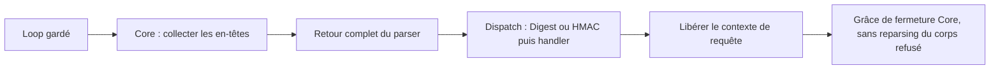

# B3 — HTTP et mémoire : livraison consolidée du 11 octobre 2026

**Livraison logicielle pour revue propriétaire ; qualification physique HOLD.**
Travail consolidé dans la [Draft PR #47](https://github.com/shinobione/SHINO-TV/pull/47),
sans nouvelle PR ni génération de firmware. Code :
[`b16d126`](https://github.com/shinobione/SHINO-TV/commit/b16d1261bd61904d5b8f23754d5425b1949dde45).
La CI du HEAD portant ce reçu doit être vérifiée séparément avant le verdict
final. Aucun résultat ci-dessous n'est une mesure du SmallTV.

## Diagnostic et correction

Le B2 installé et l'OTA physique A2→B2 réussie sont des preuves propriétaire.
Le timeout historique n'a pas de cause physique démontrée. Le minimum
historique de continuation **1968 B < 2048 B** reste un échec de qualification,
sans preuve d'overflow. Aucun reçu, marqueur de tentative ou ancien BIN n'a été
réécrit ; B3 reste non installé.

Trois coûts sont démontrés dans les sources/compilations :

1. L'ancien callback pré-corps exécutait Digest et toute l'OTA sous les frames
   `handleClient()` (64 B) et `_parseRequest()` (224 B). Le parser conservait
   aussi ses Strings temporaires pendant ces opérations. Les handlers GET/POST
   ordinaires étaient déjà appelés après retour du parser, mais restaient sous
   le dispatch Core et ses callbacks. Ce constat ne désigne pas le chemin
   physique responsable du minimum1968.
2. La B3 initiale plaçait les objets JsonDocument/String hors stack, mais les
   pools et chaînes ArduinoJson restaient dynamiques. Le Core conservait un
   corps POST dans un String et ses arguments ; les réponses et Digest
   avaient également des allocations temporaires.
3. Core3.1.2 remplace son unique nonce/opaque à chaque challenge Digest : le
   second client invalide le premier. Cette limitation est reproduite avec les
   sources réelles. Le coordinateur Windows protège les clients coopérants ;
   il ne corrige ni un client indépendant ni RF/lwIP ni un watermark historique.

La correction sépare collecte et exécution sur **le même serveur persistant**.
Le hook pré-corps marque une requête en attente puis retourne
`CLIENT_REQUEST_IS_HANDLED`. Le loop attend le retour du Core, exécute admission,
authentification et handler avant tout prochain parsing, puis libère URI,
valeurs d'en-têtes et arguments. Un garde couvre toute l'itération, rendu et
yields compris. Aucune tâche, seconde stack, second listener ou modification
du package Core épinglé n'est ajoutée. Le wrapper utilise l'ABI protégée de
Core3.1.2 et conserve ses sources/pins ; une mise à niveau Core devra le revoir.

Le POST télémétrie lit seulement après admission, dans les512 B de transfert
déjà réservés, avec la même limite384 B et le même délai **total2 s depuis la
première ligne**. Un corps incomplet/expiré ferme la connexion sans appliquer
un échantillon. Le JSON est plat (NestingLimit1), avec rejet422 si invalide ou
trop coûteux ; le payload LINK actuel et la validation FslessMetrics restent
les mêmes. Les valeurs hors limites ne remplacent jamais le dernier sample.

Les deux documents télémétrie/métriques utilisent les **768 B existants** du
buffer de réponse comme arène alignée. Elle divise, recycle, fusionne et
réalloue des blocs bornés ; elle ne retombe jamais sur malloc. Les pools
ArduinoJson sont de8 slots dans toutes les TU de ce graphe isolé ; les autres
profils du dépôt ne changent pas. Le corps de réponse métriques utilise le
buffer de transfert, pendant le même bail. Destructeurs et bail restent actifs
jusqu'au retour de l'envoi ; aucun pointeur JSON ne survit à la requête.

ArduinoJson7.4.3 copie ses chaînes, même avec une entrée mutable : une simple
arène monotone était insuffisante et a été rejetée. Le recyclage est nécessaire.
Voir les [révisions officielles](https://arduinojson.org/v7/revisions/) et le
[contrat d'allocateur](https://arduinojson.org/v7/api/jsondocument/).

Une fermeture immédiate après401 avec corps non lu a aussi été rejetée après
un reset TCP dans le banc Windows. Le wrapper conserve la grâce Core2 s,
libère immédiatement les buffers applicatifs, libère le client dès qu'un pair
est en attente et ne transforme jamais ce corps résiduel en nouvelle requête.

## Comparaison réellement mesurée

Deux compilations publiques Windows, mêmes outils/dépendances épinglés et
4m2m. Baseline = source exacte de PR47 `d25fc1a` ; candidat = commit propre
`b16d126`, `source_dirty=false`. Les nombres sont des **frames ou sections ELF**,
pas des minima physiques du B2 ni une borne native exhaustive.

| Mesure | B3 initiale | Candidat consolidé | Delta |
| --- | ---: | ---: | ---: |
| Frame telemetry |176 B|160 B|−16 B|
| Frame metrics GET |112 B|80 B|−32 B|
| Frame identity / normal-status |160 /96 B|160 /96 B|0|
| Frame réponse / admission |48 /64 B|48 /64 B|0|
| Plus grand chemin OTA compilé connu, HMAC/SHA |1840 B|1616 B|−224 B|
| Chemin SHA de readback |1296 B|1072 B|−224 B|
| Chemin segments / lecture flash |1008 B|784 B|−224 B|
| RAM statique totale |43576 B|43572 B|−4 B|
| BIN public |407792 B|407488 B|−304 B|
| Flash liée |403639 B|403331 B|−308 B|
| `.noinit` / buffer Updater |56 /4096 B|56 /4096 B|0|
| Stockage des objets JSON |76 B|80 B|+4 B|
| Buffers réponse / transfert |768 /512 B|768 /512 B|0|

La comparaison avec la fixture B2 publique de PR46 reste PASS :224→160 B pour
la frame télémétrie, +76 B statiques, sous le budget+256 B. Ne pas confondre ce
delta de64 B avec le delta de16 B depuis la B3 initiale, ni les soustraire du
watermark1968. Le nouveau dispatch a sa propre frame32 B et le loop passe
48→80 B : ces coûts sont **inclus** dans les1616 B, pas omis pour afficher un gain.
L'audit croise prologues Xtensa et `.su`, vérifie les appels parser/dispatch
comme frères et conserve tous les plafonds historiques.

Les documents JSON de ces deux handlers n'allouent plus sur le heap ; leur
capacité maximale est768 B statiques réutilisés. Le POST ne crée plus le corps
String/argument Core. Les sept objets de routes ne sont plus enregistrés.
Le URI n'est plus recopié. Ces suppressions sont vérifiables dans le graphe.
**Heap natif minimal, plus grand bloc et fragmentation avant/après : NON MESURÉS.**
Digest, en-têtes/réponses String, SDK/lwIP et le String d'erreur sémantique
gardent des allocations ; aucun gain total natif n'est inventé. Une tentative
de suppression du String de réponse augmentait sa frame48→80 et a été retirée,
sans relever le plafond. La géométrie de pools plus petits s'applique également
au chargement de configuration de ce graphe : son coût de démarrage reste à
mesurer sur l'unité, même si le montage/code historique est conservé.

Le plus grand usage **host64-bit** de l'arène observé est736/768 B, notamment
sous pression négative. Cette mesure inclut ses métadonnées et n'est pas un
chiffre d'allocation du heap ESP8266. Tous les scénarios rendent0 octet de
contenu de requête retenu. L'ancien/new heap de60000 B du simulateur n'est
pas une mesure hardware.

## Validation et limites

| Validation | Résultat local |
| --- | --- |
| Régressions ciblées outils, dont delta réel ELF |52 PASS, aucun skip final|
| Windows/LINK/sender/coordinateur/capture |95 PASS|
| Core/BearSSL/HMAC réel, flash RAM |227 cas PASS,197 frontières d'interruption|
| Lectures flash Core |320 lectures valides PASS, ancien footer refusé|
| BIN exact407488 B via receiver/Core/eboot RAM |137 refus/coupures PASS,122 frontières ; aucun commit négatif|
| HTTP réel parser/Digest/handlers sur127.0.0.1 |150 échanges conservés PASS + extensions ci-dessous|
| Deux clients Digest coordonnés |8 paires PASS ; maximum local141 ms|
| JSON invalide/imbriqué/hors plage/arène saturée |5 refus, dernier sample conservé, reprise PASS|
| Réutilisation de l'arène |256 cycles saturation/coalescence ;32 samples de reprise PASS|
| POST incomplet/déconnecté/délai2 s |2 scénarios, aucun sample partiel, reprise PASS|
| Limites payload / GPU absent / RAM totale inconnue |4 cas PASS|
| Réentrance depuis yield avec contexte réel |617 appels gardés PASS dans le run final|
| 503 workspace/upload, TTL6 s, stale/recovery |PASS|
| OTA partielle, hash invalide, framing, déconnexion readback |Abandon sans commit + reprise HTTP PASS|
| OTA publique exacte et LittleFS simulé |407488 B, un commit/reboot **simulé**, FS préservé|
| Sources firmware/companion historiques et Core |Gate Phase T/signed conservé PASS_OFFLINE|
| SmallTV, RF/lwIP, LCD réel, alimentation, heap/stack natifs |NOT_RUN / HOLD|

Le BIN public inerte a SHA256
`6e971a2d3a9179944e7443ec4cdaa8d5ff0b65974a7dc04bba90db9f2dce8ec5`.
Il n'est pas un candidat privé installable. Preuves locales publiques dans
`research-local/http-ota-ci/` et `research-local/b3-http-20261011/` ; la CI HTTP
publie ses JSON du HEAD exact. Aucune entrée privée, connexion SmallTV/AP privé,
UART/COM8, écriture flash/RTC/FS réelle, reboot réel ou merge n'a été exécuté.

Le premier essai d'arène monotone et la fermeture immédiate ont échoué puis
été corrigés. Le premier lancement local était bloqué par les permissions
PlatformIO/sockets de sandbox ; les relances autorisées sont publiques/loopback.
Le test de delta compilé, d'abord SKIP avant build, est PASS dans les52 tests
finaux. ASan/UBSan n'ont pas été exécutés localement (MSVC) ; les assertions de
bornes/réallocation/réentrance ne certifient pas l'absence de corruption native.

## Dette, décision et prochain bénéfice produit

**Poursuivre B3 consolidé est justifié.** Le placement isolé de PR47 ne suffisait
pas : conserver maintenant la séparation parser/dispatch et le budget JSON
fixe. Le gain significatif est un appel HTTP moins imbriqué et l'élimination
d'allocations répétées, sans coût RAM statique net ; aucune nouvelle architecture
OTA, génération ou PR n'est nécessaire.

Aucun outil Python n'a été ajouté. Les collecteurs de frames, chemins Xtensa,
delta B2, lab réseau et workflow existants sont réutilisés. Le collecteur lit
désormais l'entrée copiée dans **son build**, pour ne pas attribuer une source
neuve à un ELF ancien. La CI garde ses scopes/jobs ; seules ses preuves HTTP
sont élargies. Les mocks socket/flash et la dépendance au layout protégé Core
restent une dette explicite, pas une qualification matérielle.

Les trois lecteurs Windows ont des rôles distincts : observateur bref, ancien
qualificateur immuable, capture B3 bornée. Pour une future B3 choisir la
[capture existante](../companion/SHINO_B3_READONLY_CAPTURE.md), sans nouvel outil.
Les anciennes phases/pins et scripts physiques sont des preuves/consommateurs
historiques ; aucun n'est supprimé sans cartographie de son rôle. Ils ne sont
pas un backlog automatique à relancer.

Avant une qualification crédible : revue de l'arène/ABI et du candidat propre,
construction propriétaire d'un BIN privé distinct puis hash exact, décision
explicite sur une installation sûre, enfin mesures natives simultanées et
durables avec LINK/GET, absence de reboot et inventaire LittleFS identique.
Les seuils restent heap20480, bloc16384, continuation2048, fragmentation≤25%.
**Le B2 à watermark1968 ne satisfait pas l'admission OTA actuelle : ne pas
lancer une OTA B3 en ignorant ce fait, ni repaint/reboot pour maquiller le gate.**
Ce travail n'autorise aucune installation ou répétition de qualification B2.

Le prochain changement visible sur le SmallTV doit être les **mêmes quatre
cartes alimentées par des échanges HTTP plus fiables**, après installation
et qualification séparément autorisées. Horloge/météo/musique et fermeture du
boîtier attendent une réserve native démontrée. Le blocage restant est cette
qualification native et sa voie d'installation approuvée ; une CI PASS ne la
remplace pas.
