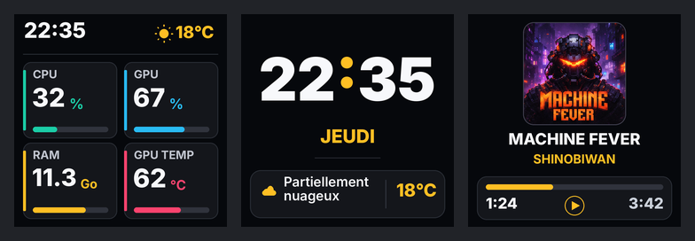

# SHINO // TV — Références UI 240 × 240 (21 octobre 2026)

> **STATUT : RÉFÉRENCES GRAPHIQUES / VALIDATION APPAREIL HOLD.**
> Les fichiers de ce dossier sont des images d'intention visuelle, pas des captures du renderer ESP8266, ni des assets firmware validés pour le flash. Les chiffres, l'heure, la météo, la lecture musicale et la pochette sont des exemples de présentation.

## Fichiers livrés et usage

| Écran | Référence native | Zoom inspection |
| --- | --- | --- |
| Monitoring | [240 × 240](../assets/ui/240x240/01_MONITORING_240x240.png) | [720 × 720](../assets/ui/240x240/01_MONITORING_ZOOM_3x.png) |
| Horloge / météo | [240 × 240](../assets/ui/240x240/02_HORLOGE_METEO_240x240.png) | [720 × 720](../assets/ui/240x240/02_HORLOGE_METEO_ZOOM_3x.png) |
| Musique | [240 × 240](../assets/ui/240x240/03_MUSIQUE_240x240.png) | [720 × 720](../assets/ui/240x240/03_MUSIQUE_ZOOM_3x.png) |

Les **trois images natives** ont été vérifiées comme PNG RGB, 240 × 240 pixels. L'aperçu comparatif mesure 784 × 272 ; il ne sert pas d'asset LCD. Les fichiers ZOOM sont des agrandissements de revue, pas des images à afficher sur le SmallTV. Voir [SHA256SUMS.txt](../assets/ui/240x240/SHA256SUMS.txt) pour identifier les octets d'origine. Le pack précédent et les expérimentations Stitch ne sont pas une preuve d'exécution matérielle.

## Contrat de composition à conserver

### Monitoring : quatre mesures simultanées

- Quatre cartes, labels **CPU**, **GPU**, **RAM**, **GPU temp**, chacun sur une ligne et plus petit que la valeur chiffrée.
- CPU et GPU : pourcentage réel. RAM : **valeur utilisée seule, en Go**, telle que `11.3 Go`, sans pourcentage textuel, capacité totale ni mention « used ». GPU temp : **°C**, jamais un pourcentage.
- Préserver les barres dynamiques : la jauge RAM peut être normalisée sur la capacité totale *mesurée*, même si la carte n'affiche que les Go. Aucune barre ne doit inventer sa valeur en l'absence de télémétrie fiable.
- Couleurs dynamiques souhaitées pour les utilisations normalisées : 0–20 % vert ; au-dessus de 20 jusqu'à 50 % jaune ; au-dessus de 50 jusqu'à 80 % orange foncé ; au-dessus de 80 % rouge bordeaux. Les seuils thermiques GPU doivent être définis indépendamment et validés : **NON VÉRIFIÉS** à ce stade. Les couleurs des maquettes sont illustratives, pas une spécification de seuil embarqué.
- Heure et température météo visibles dans l'en-tête, sans `LIVE`, `ST7789` ou bandeau diagnostic.
- Valeurs et libellés doivent être mesurés sur la vraie police embarquée, sans clipping à 0/100 %, grands nombres ou perte de LINK.

### Horloge / météo autonome

- Heure dominante en grand, **jour de semaine seul** (ex. `JEUDI`), météo exprimée en français, température et icône lisibles.
- Pas d'adresse, ville, date numérique, état technique ou footer décoratif imposé par la référence.
- Le mode doit rester possible PC éteint. La chaîne météo cible est **Open-Meteo HTTPS → VM Freebox déjà existante → LAN/Wi-Fi → SmallTV** ; ne pas introduire de HTTPS météo direct sur l'ESP8266.
- Ne pas représenter une météo inconnue/expirée comme une valeur actuelle. Ne pas réactiver la publication météo signée de la VM sans autorisation distincte.

### Musique

- Pochette **carrée 1:1**, taille libre et adaptative : aucune limite arbitraire à 64 × 64. La référence livrée utilise une vignette d'environ 116 × 116 pixels ; ce n'est pas une taille obligatoire du futur renderer.
- Titre entier si possible (`MACHINE FEVER`), artiste (`SHINOBIWAN`), barre de progression, deux durées lisibles (`1:24`, `3:42`) et indicateur distinct **Play/Pause**.
- Play/Pause est **un état affiché, pas une commande tactile**. Ne pas inventer les métadonnées, temps total ou état de lecture si non remontés.
- L'illustration de pochette de démonstration est **un visuel conceptuel**, pas l'asset officiel ni une preuve de récupération GSMTC/SHINO LINK.
- La gestion réelle d'images, de leur décodage, de leur budget mémoire, des titres longs et des scènes musicales reste à qualifier sur le firmware réel.

## Invariants UX et intégration

- Aucun scroll, navigation tactile ou page web à transposer telle quelle ; scènes exclusives sur LCD 240 × 240.
- Conserver les quatre mesures et les barres en mode Monitoring. Ne pas réduire la police des valeurs pour « faire rentrer » de la décoration.
- Scénario produit : en Automatique, afficher la scène musicale pendant une lecture reconnue **quand ce mode sera réellement disponible**, sinon le monitoring si LINK transmet, sinon horloge/météo autonome si les données sont valides ; un choix manuel explicite prime selon les contrats déjà étudiés sur les PR de SHINO LINK. Cette règle ne vaut pas preuve de disponibilité du sélecteur sur l'appareil.
- Dessin natif léger, ressources et polices réellement embarquées, cache/stream artwork borné, rendu sans écritures flash répétées. La référence PNG n'est pas un ordre de stocker trois grands fonds en LittleFS ou de modifier le layout `4m2m`.
- Aucune modification de HMAC, Digest, OTA/Updater512, partitions, LittleFS ou réseau dans cette livraison.

## Critères d'acceptation à venir (HOLD)

1. **HOST/SIMULÉ :** captures du **vrai renderer** natif à 240 × 240, comparées aux trois références ; grilles, espacements, valeurs, labels et icônes mesurés.
2. **HOST/SIMULÉ :** tests des valeurs limites, textes longs, valeur RAM + ` Go` sur une ligne, météo absente/expirée, PC déconnecté, paused/playing, temps inconnu et barres à 0/20/50/80/100.
3. **BUILD/HOST :** budgets flash/binaire, tas, plus grand bloc libre, CONT/stack, allocations dessin/image, absence de régression LINK, authentification, LittleFS et OTA.
4. **APPAREIL :** uniquement après GO explicite pour le candidat exact : photo/vidéo de l'écran réel, distance de lecture, 240 × 240, luminosité/contraste, stabilité, reconnexion, transitions et cas dégradés.
5. **SORTIE :** acceptation visuelle propriétaire ; ne pas assimiler un PASS CI ou des PNG à un écran physique validé.

Pour les dépendances et l'ordre du travail, consulter [la roadmap](ROADMAP.md) et le [checkpoint opérationnel](PROJECT_STATE.md).
