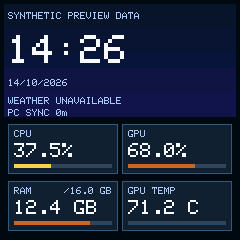
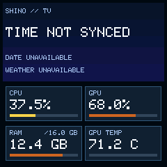
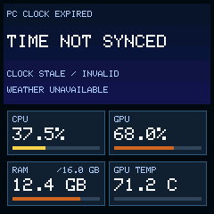
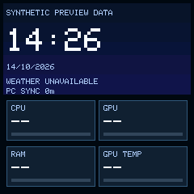
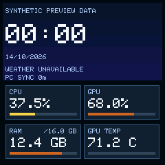

# Actual B5.2 renderer captures — HOST only

Each image was produced independently at **240x240** by actual C++ SceneEngine,
RGB565 software canvas and pinned GFX1.6.4 classic font. Synthetic HOST clock/
metric fixtures, not SmallTV screenshots or a Freebox/time-sync pass. Every
displayed fixture clock is marked SYNTHETIC PREVIEW DATA. Invalid/expired
captures display no time.

| State | Capture |
| --- | --- |
| Synchronized IDLE + four metrics |  |
| Boot with no clock |  |
| Expired clock; metrics retained |  |
| PC telemetry absent; bounded clock holdover |  |
| Local midnight/date rollover |  |

CPU/GPU/RAM normalization, 20/50/80 boundaries and 2-point hysteresis remain the
existing policy. GPU temperature retains a neutral track. No weather/artwork
receiver/full native framebuffer added; native scanline448 B rather than the
HOST115200-byte pixel array.

Reproduce with tools/shino_b52_clock_runner.py, a **new** ignored output directory
and an already installed GFX1.6.4 src folder. The lab has no socket or private
identity. [Decision and resources](../B52_CLOCK_FOUNDATION.md).

